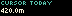

# Cursor Odometer

See how far the pointer traveled across your screens today and yesterday.

Run swift companion/cursor.swift ~/cursor-totals.json. The sampler uses each display’s millimeters per logical point. If macOS reports incorrect physical size, pass your measured mm-per-point as the second argument. Cross-display jumps and long gaps are excluded. The result measures the sampled cursor path on the display, not centimeters of mouse movement across a desk. No pointer positions are written. Set totals_file to the same file.

## Connect the bar

Copy companion/example.json to a private config.json and adjust it for your source. From the project folder run `python3 companion/serve.py --config config.json`. Use Python 3.10+. Set Local companion URL to `http://127.0.0.1:8770/reading` on the emulator and allow local port 8770. On hardware, bind the companion to a trusted LAN interface and set its reachable address. The wheel browses pages. Click refreshes. Start pins or unpins the current page. The last good reading is labeled offline after a source error.

## Run locally

From this folder, run `~/.busy-emulator/bin/busy-emulator dev --once` with BUSY Bar Emulator open. Back exits.

