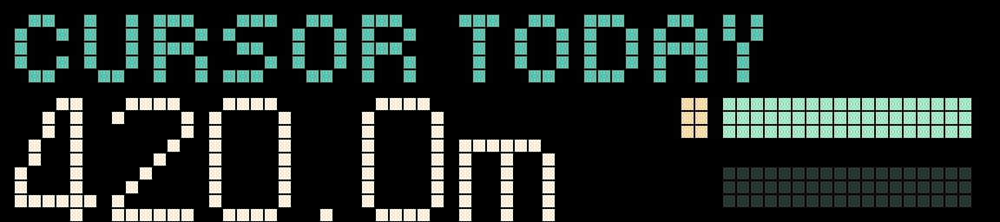
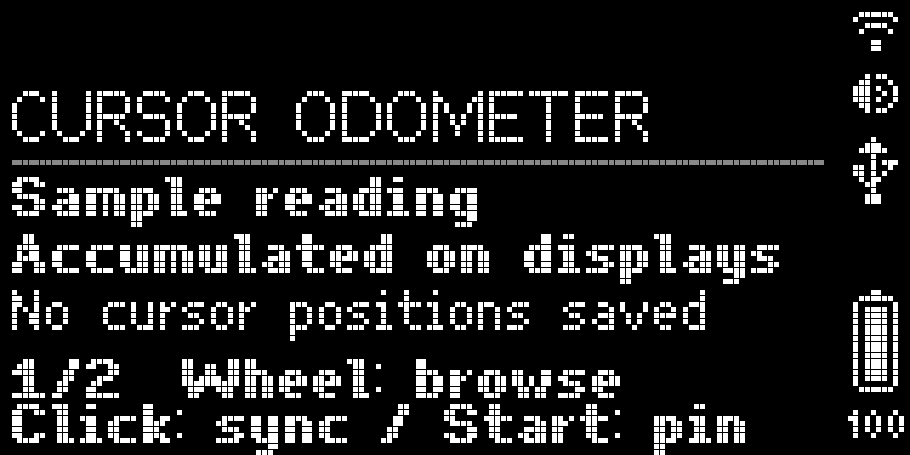

# Cursor Odometer

See how far the pointer traveled across your screens today and yesterday.

A long pointer trip is easy to miss across two monitors. Keep today’s total in sight and compare it with yesterday without recording where you went or which apps you used.

The upper strip shows today’s pointer travel and the lower strip shows yesterday’s. The longer distance fills its track. A pale dot identifies the selected day, including when its distance is zero.

## Screen transitions

Watch the selection change between days. The two distance strips use the recorded totals.



<details>

<summary>Watch the rear display</summary>



</details>

## Compare two days of pointer travel

1. Run the Mac collector before starting work and point the companion at its totals file.
2. Read **CURSOR TODAY** for the sampled distance along the display surfaces. The recording starts at 420.0 m.
3. Turn the wheel to **YESTERDAY**. The example has no distance for that day and reads 0.0 m.


## Calibrate a display and check the total

1. If the monitor reports the wrong physical size, measure its scale and pass millimeters per logical point to the collector as described below.
2. Turn the wheel back to today. Click to fetch the latest stored total once the collector has written new movement.
3. Read the figure as distance traveled by the on-screen pointer. Measuring hand travel on the desk would require a different measurement.


## Example from the emulator

A cross-display jump is excluded because there is no sampled path over the physical gap. Long gaps are excluded too. The totals file used for this recording contained daily distances only. The sample totals were supplied in the Mac collector’s daily file format.

## Set up the source

Run swift companion/cursor.swift ~/cursor-totals.json. The sampler uses each display’s millimeters per logical point. If macOS reports incorrect physical size, pass your measured mm-per-point as the second argument. Cross-display jumps and long gaps are excluded. The result measures the sampled cursor path on the display, not centimeters of mouse movement across a desk. No pointer positions are written. Set totals_file to the same file.

## Connect the bar

Copy companion/example.json to a private config.json and adjust it for your source. From the project folder run `python3 companion/serve.py --config config.json`. Use Python 3.10+. Set Local companion URL to `http://127.0.0.1:8770/reading` on the emulator and allow local port 8770. On hardware, bind the companion to a trusted LAN interface and set its reachable address. The wheel browses pages. Click refreshes. Start pins or unpins the current page. The last good reading is labeled offline after a source error.

## Run in the emulator

Open BUSY Bar Emulator. From this repository, run:

```sh
~/.busy-emulator/bin/busy-emulator dev --once
```

Press **Back** to exit.

The GIFs are excerpts from the emulator recording. Each LED occupies a 16 × 16 cell with a black border. The end frames pause for reading.

[Full recording](media/controls.mp4) · [Rear display](screenshots/back-1.png) · [Firmware test](EMULATOR-QA.md) · [MIT license](LICENSE)
